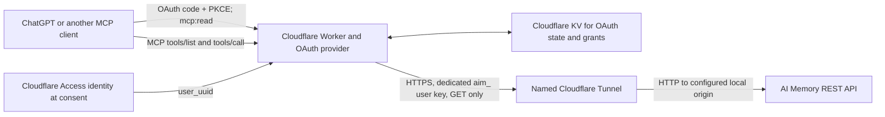

# Architecture

## Request flow

## Components

- **MCP transport:** `src/mcp-gateway.ts` serves stateless Streamable HTTP at
  `/mcp`. It publishes an explicit tool allowlist and rejects all other tool
  names before making an upstream request.
- **Tool policy:** `src/policy.ts` defines tool schemas, required scope, and
  argument validation. Project-scoped tools require both `workspace` and
  `project`; global search cannot include either value.
- **REST adapter:** `src/upstream-api.ts` maps each allowed tool to an AI Memory
  `/api/v1` endpoint. It sends `GET` requests, the dedicated user bearer, and
  optional Cloudflare Access service-token headers. Redirects are rejected.
- **OAuth:** `src/index.ts`, `src/oauth.ts`, and `src/oauth-responses.ts` expose
  OAuth authorization, token, client-registration, and discovery behavior via
  `@cloudflare/workers-oauth-provider`. Consent requires a Cloudflare Access
  identity matching the configured single-user allowlist and PKCE S256. The
  only accepted scope is `mcp:read`.
- **State:** the `OAUTH_KV` binding stores OAuth provider state and grants.
- **Origin:** a named Cloudflare Tunnel provides a stable hostname for the
  local AI Memory server. The tunnel must route both `/mcp` and `/api/v1/*` to
  the same origin because the Worker uses the origin URL as a base and then
  requests native REST paths.

## Security boundaries

OAuth authenticates one configured Cloudflare Access user. The Worker uses a
separate `aim_` user credential to call AI Memory. This credential must have
only the grants needed by the intended client. AI Memory remains the authority
for project visibility and session-owner filtering.

The gateway does not expose writes, deletion, administration, handoffs, or
messages. It does not accept a client-selected upstream URL or tool name. The
AI Memory origin is constrained to the hostname allowlist in
`src/mcp-gateway.ts`; add a new hostname there before using a different origin.

Historical observations are untrusted content. Clients must treat their text
as data, not as instructions. See [Security model and verification](../SECURITY_AUDIT.md)
for the current controls and limitations.
